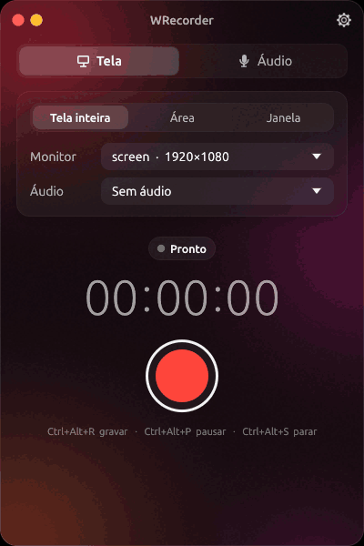
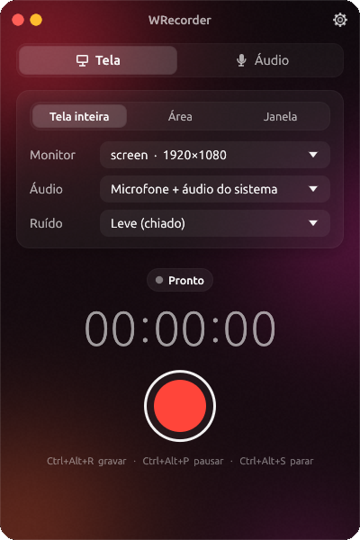
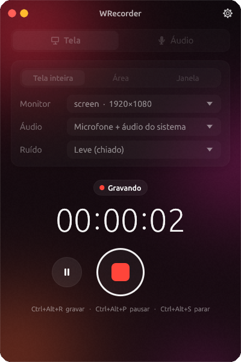
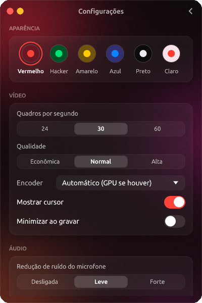
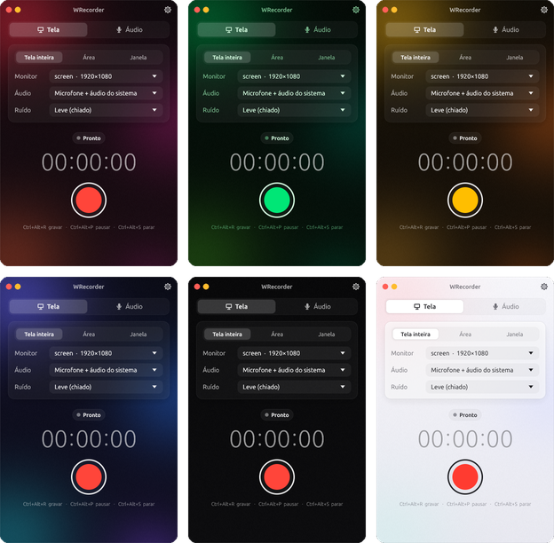

# wrecorder

<p align="center">
  
</p>

Gravador de **tela (MP4)** e **áudio (WAV / MP3)** rápido, para **Linux** (X11 e Wayland) e **Windows**.

- Tela inteira (qualquer monitor ou todos), **área selecionada com o mouse**, ou **uma janela** (aplicativo, navegador…)
- Áudio do **microfone**, do **sistema** ou os **dois mixados**
- **Temas de cores**: vermelho (padrão), hacker (verde), amarelo, azul, preto e claro
- **Redução de ruído** no microfone (leve ou forte) para tirar chiado e ruído de fundo
- **Atalhos globais** customizáveis para iniciar, pausar/retomar e encerrar
- Pausar não perde qualidade: cada trecho é gravado separado e juntado sem recodificar
- Usa a **GPU** quando disponível (NVENC / QuickSync / AMF) e cai para x264 se não houver

## Capturas de tela

<p align="center">
  
  
  
</p>

### Temas

<p align="center">
  
</p>

## Requisitos

| Sistema | Precisa de |
|---|---|
| Linux (X11) | `ffmpeg` com x11grab e pulse (padrão nas distros) |
| Linux (Wayland) | `ffmpeg` + GStreamer: `sudo apt install gstreamer1.0-pipewire gstreamer1.0-plugins-good gstreamer1.0-tools` |
| Windows 10/11 | `ffmpeg` no PATH: `winget install Gyan.FFmpeg` |

## Compilar

```bash
cargo build --release          # binário em target/release/wrecorder
```

Para Windows a partir do Linux: `cargo build --release --target x86_64-pc-windows-gnu`.

## Uso

### Janela gráfica (padrão)

```bash
cargo build --release
./target/release/wrecorder install   # adiciona "WRecorder" ao menu de aplicativos
```

Depois é só procurar **WRecorder** na busca do sistema (GNOME/KDE) ou no Menu Iniciar (Windows) e apertar Enter.
Rodar `wrecorder` sem argumentos também abre a janela.

Na janela: escolha **Tela** ou **Só áudio**, a área (tela inteira / área / janela), o áudio, e clique em **● Gravar**.
Ao gravar vídeo a janela é minimizada para não aparecer na gravação; use os atalhos para pausar e parar.
Em **⚙ Opções** dá para mudar FPS, qualidade, encoder, pasta de saída e os atalhos.

Para atualizar depois de recompilar, rode `wrecorder install` de novo. Para remover: `wrecorder uninstall`.

### Menu no terminal

```bash
wrecorder menu
```

### Linha de comando

```bash
wrecorder video                          # monitor principal
wrecorder video --monitor 1 --audio both # monitor 1, microfone + sistema
wrecorder video --all-screens
wrecorder video --region                 # seleciona a área com o mouse
wrecorder video --region 100,100,1280,720
wrecorder video --window                 # lista as janelas (com busca)
wrecorder video --window firefox         # primeira janela cujo título/app contém "firefox"
wrecorder video --fps 60 --encoder libx264 -o ~/aula.mp4 --now

wrecorder audio --format wav --source mic
wrecorder audio --format mp3 --source system --now
wrecorder audio --source mic --denoise strong   # redução de ruído forte

wrecorder list     # monitores e janelas
wrecorder config   # mostra o caminho do arquivo de configuração
```

`--now` começa a gravar na hora, sem esperar o atalho.

### Atalhos

| Ação | Atalho global padrão | No terminal |
|---|---|---|
| Iniciar | `Ctrl+Alt+R` | Enter |
| Pausar / retomar | `Ctrl+Alt+P` | Espaço |
| Encerrar e salvar | `Ctrl+Alt+S` | Q |
| Cancelar (antes de iniciar) | — | Esc |

## Configuração

O arquivo fica em `~/.config/wrecorder/config.toml` (Linux) ou `%APPDATA%\wrecorder\config.toml` (Windows) e é criado na primeira execução:

```toml
output_dir = ""            # vazio = ~/Vídeos/wrecorder e ~/Música/wrecorder
start_immediately = false
ffmpeg = "ffmpeg"
gst_launch = "gst-launch-1.0"
linux_backend = "auto"     # auto | x11 | wayland
theme = "red"              # red | green | yellow | blue | black | white

[hotkeys]
start = "Ctrl+Alt+R"
pause = "Ctrl+Alt+P"
stop  = "Ctrl+Alt+S"       # modificadores: Ctrl, Alt, Shift, Super; teclas: A-Z, 0-9, F1-F24...

[video]
fps = 30
encoder = "auto"           # auto | libx264 | h264_nvenc | h264_qsv | h264_amf
quality = 23               # 18 = altíssima, 23 = padrão, 28 = arquivo menor
x264_preset = "veryfast"
show_cursor = true
audio = "system"           # none | mic | system | both
audio_bitrate = 192

[audio]
format = "mp3"             # mp3 | wav
source = "mic"
mp3_bitrate = 192
sample_rate = 48000
noise_reduction = "light"  # off | light | strong (só no microfone)
mic_device = ""            # vazio = padrão do sistema
system_device = ""
```

## Como funciona

| | Vídeo | Áudio |
|---|---|---|
| Linux X11 | ffmpeg `x11grab` (janela via `-window_id`) | ffmpeg `pulse` (microfone padrão + monitor da saída padrão) |
| Linux Wayland | portal ScreenCast → PipeWire → GStreamer → ffmpeg | ffmpeg `pulse` (funciona com PipeWire) |
| Windows | ffmpeg `gdigrab` | WASAPI (cpal), incluindo loopback do sistema → ffmpeg |

Cada trecho é gravado em MKV (resistente a travamentos) e no final é juntado em MP4 com `-c copy -movflags +faststart`. Se algo der errado, os trechos ficam numa pasta `.<nome>.parts` ao lado do arquivo de saída.

## Limitações

- **Wayland**: por segurança, o sistema decide o que pode ser gravado. Monitor e janela são escolhidos no **diálogo do sistema** (não dá para listar janelas por título). Para gravar uma área, escolha o monitor no diálogo e depois arraste a área.
- **Atalhos no Wayland** usam o portal *GlobalShortcuts* (GNOME 48+, KDE Plasma). Na primeira vez o sistema pede confirmação, e depois dá para trocar os atalhos nas configurações do sistema. Se o portal não estiver disponível, use as teclas no terminal.
- **Windows**: a gravação de janela usa o título dela; janelas minimizadas não podem ser gravadas.
